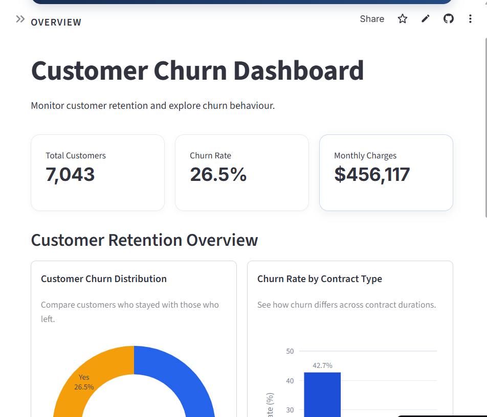
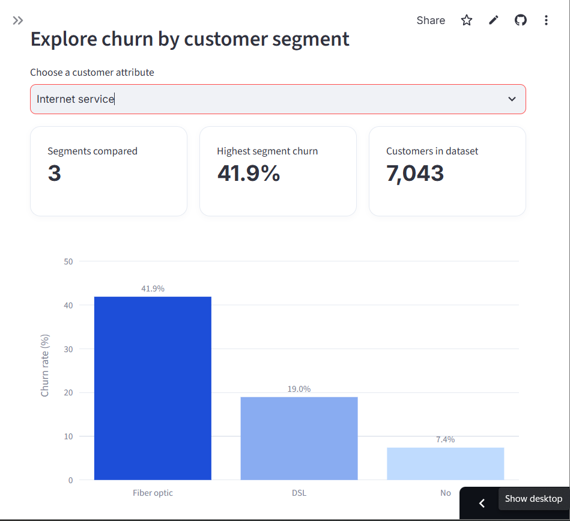
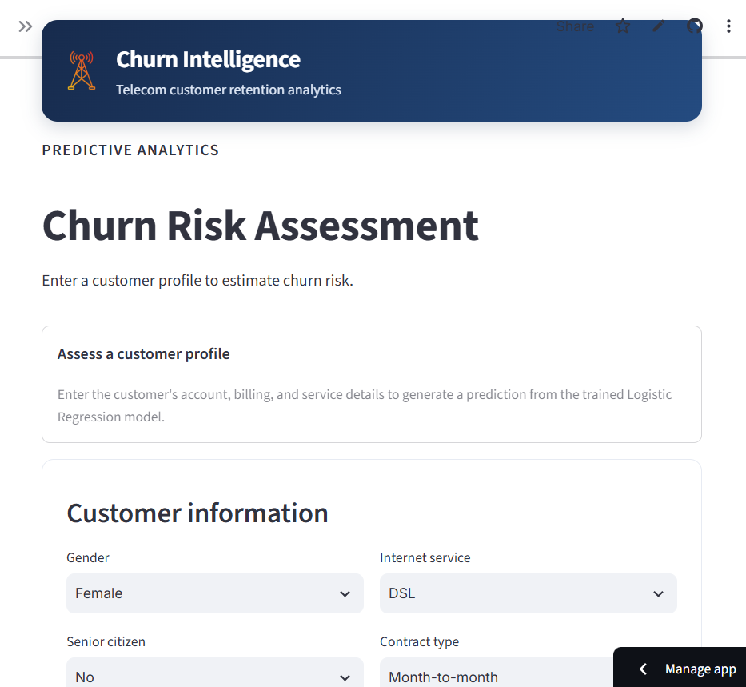
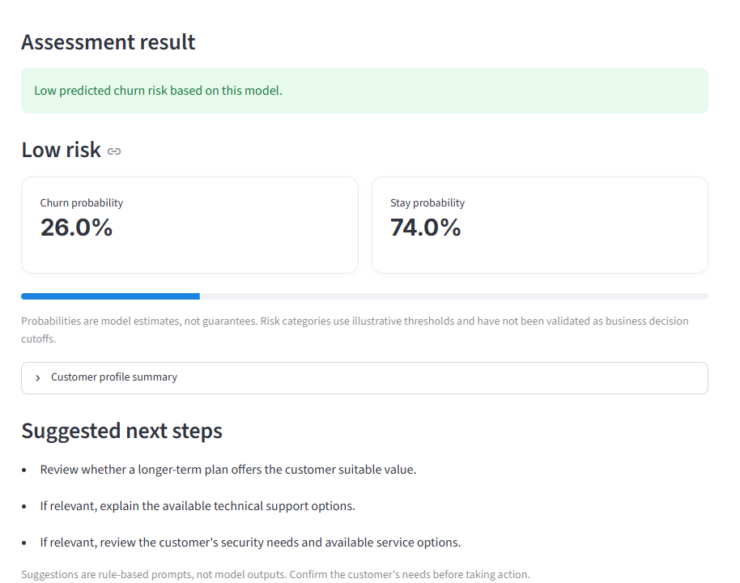

# Telecom Churn Intelligence

A machine-learning dashboard for exploring customer churn patterns and
estimating the likelihood that an individual telecom customer will
churn.

This capstone project combines customer analytics with a trained
Logistic Regression model in an interactive Streamlit application.

Live URL: https://telchurn.streamlit.app/prediction

## Features

- **Overview dashboard:** high-level customer and churn metrics, churn
  distribution, and a customer preview.
- **Customer insights:** explore churn patterns across segments such
  as contract type, internet service, payment method, and tenure.
- **Churn risk assessment:** enter a customer's account, billing, and
  service details to receive a model-based churn estimate and
  probability.
- **Retention prompts:** view simple rule-based suggestions to help
  guide a customer-retention review.

> **Important:** Predictions are estimates, not guarantees. The
> displayed risk bands use illustrative thresholds and are not validated
> business decision cutoffs. Retention prompts are rule-based and are
> not generated by the machine-learning model.

## Tech stack

- Python
- Streamlit
- pandas
- scikit-learn
- Joblib
- Plotly

## Project structure

The main files and folders are expected to follow this layout:

```text
telecom-churn-ui/
├── app.py
├── data/
│   └── telco_churn.csv
├── models/
│   └── logistic_regression_bundle.joblib
├── views/
│   ├── insights.py
    ├── overview.py
    └── prediction.py
├── requirements.txt
└── README.md
```

## Dashboard Preview

### Overview



### Customer Insights



### Churn Risk Assessment





## Getting started

### 1. Clone the repository

```bash
git clone https://github.com/barakatokikiola/telecom-customer-churn.git
cd telecom-churn-ui
```

### 2. Create and activate a virtual environment

### 3. Install dependencies

```bash
pip install -r requirements.txt
```

Use the dependency versions specified by the project. The saved model
bundle was created with scikit-learn **1.6.1**, so use a compatible
version when loading it.

If you do not yet have a `requirements.txt`, install the main packages
with:

```bash
pip install streamlit pandas plotly joblib scikit-learn==1.6.1
```

### 4. Check the required files

Confirm that the model bundle exists at:

```text
models/logistic_regression_bundle.joblib
```

The prediction page loads this bundle, which contains the trained model,
preprocessing pipeline, feature-column information, target classes, and
feature-engineering metadata.

If the dashboard loads customer data from a CSV, confirm that the
expected dataset is available at:

```text
data/telco_churn.csv
```

### 5. Run the dashboard

From the project root, run:

```bash
streamlit run app.py
```

Streamlit will print a local URL in the terminal, typically
`http://localhost:8501`.

## Model and prediction workflow

The churn assessment workflow:

1.  Collects a customer's account, service, contract, and billing
    details.
2.  Derives `AverageMonthlySpend` from total charges and tenure, using
    monthly charges when tenure is zero.
3.  Arranges values in the feature order expected by the saved model
    bundle.
4.  Applies the saved preprocessing pipeline.
5.  Uses the trained Logistic Regression model to estimate churn and
    stay probabilities.
6.  Displays the estimate alongside a risk band and rule-based retention
    prompts.

The model uses a binary target: `Churn` (`Yes` or `No`). Predictions
depend on the quality and compatibility of the input data, preprocessing
pipeline, and saved model.

## Evaluation snapshot

The recorded evaluation metrics for the Logistic Regression model were:

Metric Score

---

Accuracy 0.800
F1 score 0.592
ROC-AUC 0.842

These are recorded model-evaluation results, not a guarantee of
performance on new customers. Accuracy alone may not adequately reflect
churn detection quality, particularly when the target classes are
imbalanced.

## Deployment notes

For Streamlit Community Cloud or another hosting platform:

- Set the application entry point to `app.py`.
- Include required Python packages in `requirements.txt`.
- Ensure the model bundle is included in the repository or made
  available securely to the deployed app.
- Check that the model was saved with a compatible scikit-learn
  version.
- Use repository-relative paths where possible, rather than
  machine-specific absolute paths.
- Test the deployed prediction workflow with a sample customer
  profile.

Do not commit credentials, API keys, or other secrets to the repository.

## Limitations

- Predicted probabilities are model estimates and may not be well
  calibrated.
- Risk categories are illustrative until appropriate business
  thresholds are validated.
- Rule-based retention prompts are suggestions for review, not
  guarantees of successful retention.
- Model performance may change when applied to customers whose
  behavior differs from the training data.

## Future improvements

- Validate and document decision thresholds for the risk bands.
- Monitor the model and evaluate performance by churn class.
- Improve input validation and customer-profile consistency checks.
- Add tests for preprocessing and prediction behavior.
- Document data provenance and responsible use of customer
  information.

## Project status

An interactive Streamlit dashboard with customer analytics and a
saved-model churn prediction workflow.
